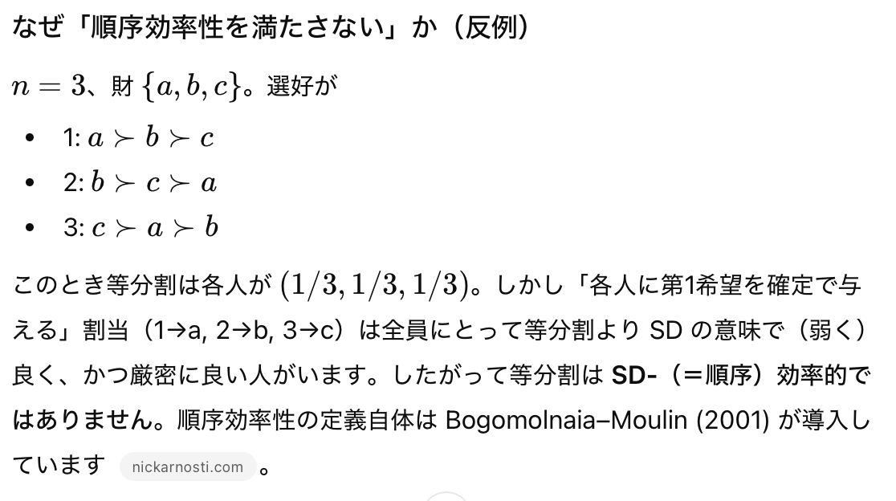

- regert netみたいにやる　別の先行プロファイルを入れたとき満たさないよ　学習段階で適当に10こぐらい入れたとき満たすように　テスト段階でちゃんと満たすように
- 式で組み込む
- 出力したいのは確率がどうなるか
- 対戦略性と無羨望性満たして順序効率性満たしてないメカニズムと比べる　考えよう！
- 等分割メカニズム　Equal Division
  - 選好に関係なく各人に各財を同じ確率で配る
  - 人数n、財もnなら各人は各財を$\frac{1}{n}$で受け取る
- original matching を順序効率性と耐戦略性を満たすメカニズムにしたい　同じ効用でシリアルディクテーターシップでゼロになるか　envy freeは無視　DSD
- PSとかも
- $P'$のつまりP0の候補を30個ぐらい作って比べたい
- DSDとその３０個を比較してちゃんと侵害が０になっているか
- OE侵害　平均と最悪があるが重いから平均にした
- 確定的独裁制で順序効率性０になっているか確認
- 等配分の侵害がちゃんとでかくなっているか
- 案３
- 学習30個ぐらい　サンプルvsメカニズムが出した確率行列
- sの式にちゃんとP’入れる　確率行列30個とかになるのでは？
- テスト　100ぐらい　結果の平均とる　比較対象DSD 
- 自作メカニズムvs等配分vsDSD　100個のやつの確率支配の侵害の平均　割合が小さくなってたらハッピー！
- 選好固定して確率行列30個ぐらいで学習　100個ぐらいでテスト　regretnetで選好をサンプリング
- 0.2で全探索してみる？
- phi 50にする
#
- 選好　30個選ぶ(learn)　100個変える(test)　regretnet
- P’ learnとtestで両方0.2刻み
- $a_k$ iさんがk番目に好き
- Pの最初はDSDにしよ　確定的逐次独裁制　順序効率性と耐戦略性を満たす
- 全ての選好の二重確率行列を考えて大きな表を出力したい
- 